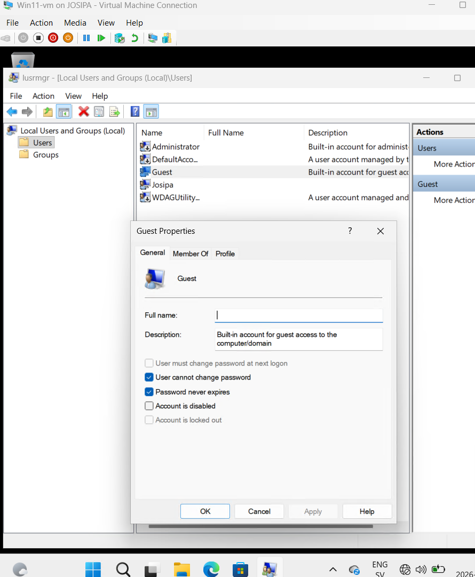
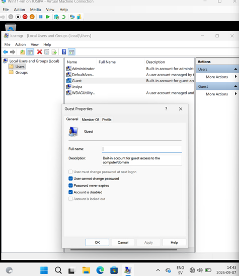
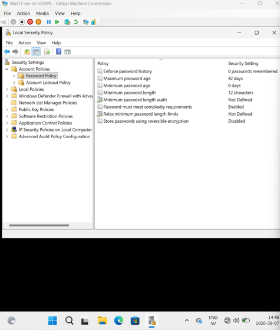
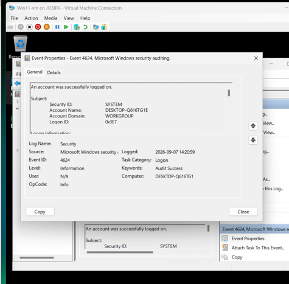

# 01 — Windows 11 Hardening (CIS Benchmarks)

**Environment:** Windows 11 virtual machine (Hyper-V)

This documents the hardening steps applied to a Windows 11 VM, comparing the default
configuration against CIS Benchmark recommendations. For each item I record the starting
state, the change performed, and the resulting state. All settings below are aligned with
CIS Benchmark recommendations for Windows 11.

## Steps and evidence

### Guest account *(aligned with CIS Benchmark – Accounts)*
The built-in Guest account was **enabled by default** and was then disabled.

Before:

After:

### Administrators group
Reviewed the membership of the local Administrators group (no changes made): Administrator
and Josipa.

### Password policy *(aligned with CIS Benchmark – Password Policy)*
Set the **minimum password length to 12 characters** and enabled **complexity
requirements** (`secpol.msc` -> Account Policies -> Password Policy), applied with
`gpupdate /force`. A test account confirmed a weak password was rejected.

### Account lockout policy *(aligned with CIS Benchmark – Account Lockout)*
Configured a threshold of **5 invalid attempts**, a **15-minute lockout duration**, and a
15-minute reset of the lockout counter.

### Firewall profiles *(aligned with CIS Benchmark – Windows Firewall)*
All three profiles — Domain, Private, Public — were **already on by default**. No changes
needed.

### BitLocker
BitLocker **could not be completed** because two DVD/ISO drives were mounted on the VM.
`manage-bde -status` showed Protection Status Off, 0% encrypted. Documented as an
environment limitation rather than ignored.

### Security logging *(aligned with CIS Benchmark – Audit Policy)*
Enabled **Audit logon events** and **Audit policy change** (Success and Failure), then
generated and located a logon event in Event Viewer (**Event ID 4624**, successful logon).

## Reflection

The most surprising part was how many important security settings are **not enabled by
default**: the Guest account was active, the password policy allowed short/simple
passwords, and detailed auditing was off. A freshly installed Windows 11 system is usable
out of the box, but **not secure** out of the box — hardening is a separate, deliberate
step.

The biggest gaps versus CIS Benchmarks were in account and password settings. The firewall
was the exception: all three profiles were already enabled. Easiest changes: disabling
Guest and setting password/lockout policies. Hardest: BitLocker — which in the end could
not be completed due to mounted ISO drives, a good reminder that hardening depends on the
environment, and that limitations should be documented rather than hidden.
