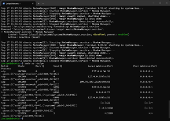
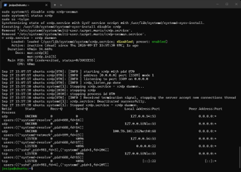
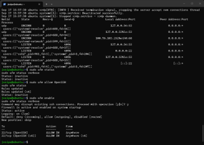
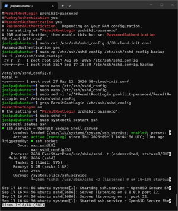

# 02 — Ubuntu Server Hardening (Defense in Depth)

**Environment:** Ubuntu Server 24.04 LTS virtual machine (Hyper-V), accessed over SSH

This documents the hardening steps applied to an Ubuntu Server VM, compared against a
recommended security baseline aligned with CIS Benchmark recommendations for Ubuntu Linux.

## Steps and evidence

### System orientation and users
Reviewed `/etc/passwd` to tell real accounts from service accounts — service accounts such
as `www-data`, `sshd`, `systemd-resolve`, `syslog` use `/usr/sbin/nologin` or `/bin/false`,
so they cannot be used for interactive login. `sudo -l` confirmed the user has `(ALL : ALL)
ALL`. Acceptable for a single-admin lab; in production, sudo would be scoped per role.

### File permissions *(aligned with CIS Benchmark – Filesystem permissions)*
Stepped a test file through `chmod 600/644/700/777`. Compared `/etc/passwd` (644) with
`/etc/shadow` (640) — reading `/etc/shadow` as a normal user correctly returned
**Permission denied**.

### Services and open ports *(aligned with CIS Benchmark – Services)*
Found **20 services running by default**, including `xrdp` (Remote Desktop) listening on
**port 3389 across all interfaces (0.0.0.0)** on a headless server, and `ModemManager`.
Both were stopped and disabled — afterwards only port 22 (SSH) and local DNS remained.

Before (xrdp exposed):

After (only SSH remaining):

### UFW firewall *(aligned with CIS Benchmark – Host firewall)*
UFW was **inactive by default**. Following correct change-management order, allowed SSH
**before** enabling the firewall (to avoid losing remote access), then enabled UFW with
default **deny incoming / allow outgoing**, permitting only SSH.

### SSH hardening *(aligned with CIS Benchmark – SSH server)*
Backed up the config first. Changed **`PermitRootLogin` to `no`**, verified syntax with
`sshd -t`, restarted, and confirmed access still worked from a **second independent SSH
session** before trusting the change. (Password auth left on, as no SSH key pair was
configured yet.)

### AppArmor & patching
`aa-status` showed many profiles defined, `rsyslogd` in enforce mode. `apt list
--upgradable` reported 182 pending packages; `unattended-upgrades` active. Full upgrade
deferred this session (time + restart risk) and documented as an open item.

## Defense in depth & top risks

- **"Just give me root, it's easier"** — individual accounts + sudo are preferable: every
  privileged action is logged under a specific user, and a compromise is limited.
- **`chmod 777` as a quick fix** — widens access to everyone; grant only the specific
  user/group the minimum needed.
- **"Updates pending, but it works"** — a working system is not a secure one; patching
  should be scheduled, not deferred.
- **SSH open with passwords** — move to key auth, restrict the SSH rule to admin IPs,
  consider `fail2ban`.

**Layers on this server:** UFW filters traffic -> SSH controls authentication -> sudo
governs actions -> file permissions control data access -> AppArmor restricts process
behaviour -> logging supports detection. If one layer fails, the others still limit damage.

## Recommended baseline (top 5)

1. Disable direct root SSH login (`PermitRootLogin no`).
2. Enable UFW with default-deny incoming, allowing only required services.
3. Disable unnecessary services (remote desktop, unused GUI components).
4. Establish a regular, scheduled patch cycle.
5. Move to SSH key-based authentication and disable password auth once keys are in place.

## Note on limitations

Performed in a Hyper-V VM over SSH. The VM's IP changed once mid-session after a DHCP lease
change, requiring a reconnect. The full package upgrade (182 pending) was not performed this
session due to time and restart risk — documented rather than left unmentioned.
