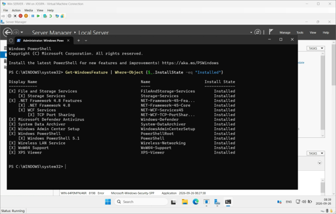
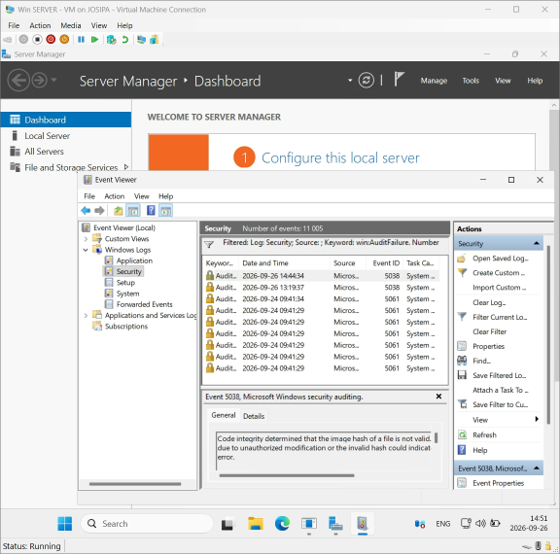
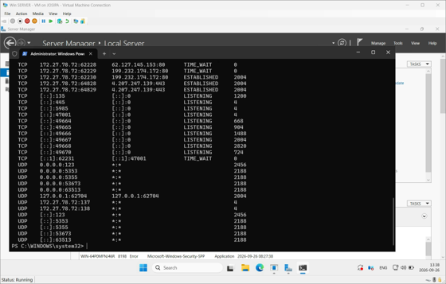

# 03 — Windows Server 2025: Baseline, Hardening & Active Directory

**Environment:** Windows Server 2025 virtual machine (Hyper-V), later promoted to a
Domain Controller for the fictional domain `lab.local`

This is the most advanced part of the project: establishing a full baseline, applying basic
hardening, then promoting the server to a **Domain Controller** and analysing how that
changes its security posture.

## Part 1 — Baseline and basic hardening (before AD)

Documented the server's starting state before any change: OS version, hostname, users,
roles/features, listening ports, firewall, and Defender status.



Key findings:
- **Firewall:** all three profiles on by default; Inbound Block, Outbound Allow.
- **Microsoft Defender:** antivirus and real-time protection enabled, signatures current;
  QuickScan and FullScan found no threats.
- **Guest account:** already disabled. **Administrators group:** only built-in
  Administrator. Both already secure.
- **Patching:** missing **5 security updates** despite a fresh install — all installed.
- **Logging:** reviewed the Security log, including Event IDs 4624 (logon), 4672 (special
  privileges), 5379 (credential read). "Audit Failure" entries coincided with Windows
  Update and were assessed as **not** a security incident.



Each checkpoint used: **Current state -> Risk -> Decision -> Change -> Verification ->
Result**.

## Part 2 — Promotion to Domain Controller

Before installing AD, I formed five hypotheses — more services, new ports, DNS role
auto-installed, changed user model, more firewall rules — **all five later confirmed.**

```powershell
Install-ADDSForest -DomainName "lab.local" -DomainNetbiosName "LAB" -InstallDNS -Force
```

## Part 3 — What changed, and why it matters

New listening ports after promotion (DNS, Kerberos, LDAP, Global Catalog, etc.):



| Area | Before | After |
|---|---|---|
| Server role | Member server (workgroup) | **Domain Controller** |
| Running services | baseline | 102 |
| Listening ports | local/RPC only | + 53 (DNS), 88 (Kerberos), 389/636 (LDAP/LDAPS), 464, 3268/69 (GC), 9389 |
| Firewall rules | baseline | 224 active |
| User model | local SAM (4 accounts) | domain-based (+ **krbtgt**) |
| Log sources | Security only | + Directory Service, DNS Server |

**Attack-surface analysis:** the surface grew — but not necessarily "less secure", because
the server gained an intended function (domain identity). The new services are required for
it; what increases is the **need to harden and monitor** the larger surface.

**Criticality:** before, a compromise hit one machine. After promotion, the DC handles
identity, authentication, admin groups and Group Policy for the **entire domain** — making
it a **Tier 0** system.

## Hardening recommendations after AD

1. Keep Domain Admins membership minimal; review regularly.
2. Separate everyday and administrative accounts.
3. Introduce **privilege tiering** (T0 = DC/AD, T1 = servers, T2 = clients).
4. Set a static IP on the DC.
5. Centralise logging/SIEM for Security, Directory Service and DNS logs.
6. Enable AD Recycle Bin; document and test backup/recovery (including the DSRM password).
7. Prefer Kerberos; reduce NTLM where possible.
8. Plan a **second Domain Controller** for redundancy.

**Principles applied:** One Server – One Purpose; Least Privilege (not everyone is Domain
Admin); restrict RDP to a management network / jump host; and backup matters because
prevention lowers the likelihood of an incident, but recovery determines whether the
environment survives one. A DC should follow a **stricter baseline** (Microsoft Windows
Server 2025 Security Baseline or CIS Benchmark) than an ordinary member server — always
tested before production, since overly strict settings can break AD (Kerberos, replication).

## Note on limitations

Performed in a Hyper-V VM. The network adapter was moved from WAN Switch to Default Switch
due to unstable connectivity. Some raw baseline command outputs were not retained and can be
regenerated if needed.
